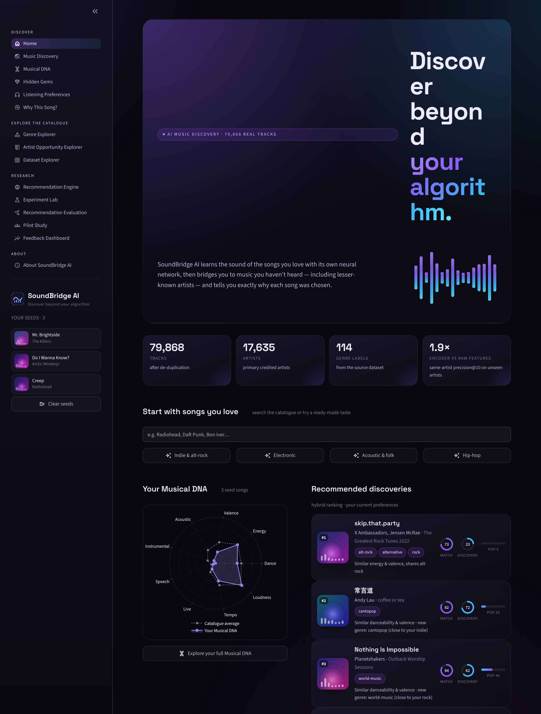
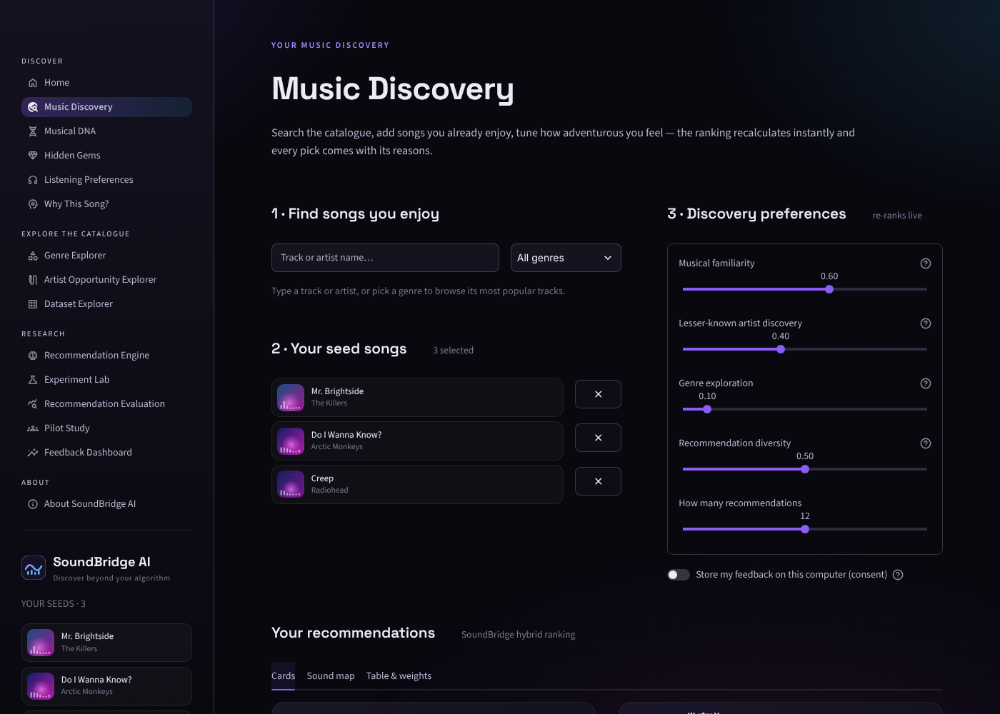
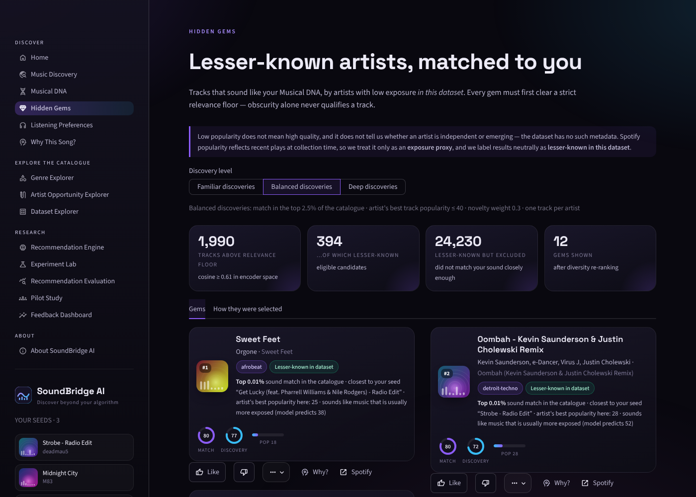
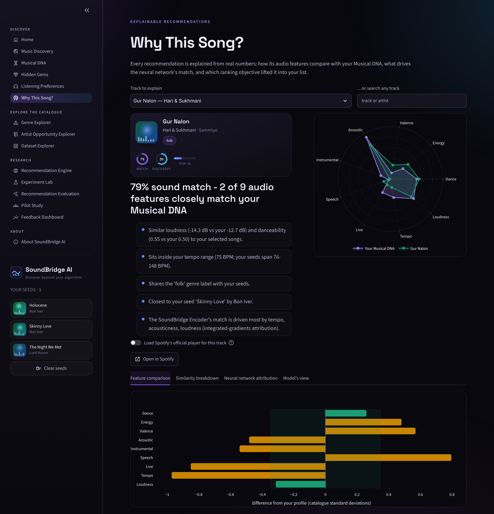

# SoundBridge AI — Discover Beyond Your Algorithm

SoundBridge AI is a music discovery platform built around its own neural network. You pick songs you already enjoy;
it learns the sound of your taste, then recommends music beyond it, including relevant **lesser-known artists**,
and explains every pick from real numbers.

It is also a research platform. It asks whether a recommender can balance personal preference, musical diversity
and visibility for lesser-known artists, and it measures the answer instead of asserting it.

* Real data: 114,000 rows from the public Spotify Tracks Dataset, cleaned to 79,868 unique songs.
* A neural network trained from scratch on CPU (about 2.5 minutes), evaluated on artists it never saw.
* Seven ranking strategies, compared in a reproducible Experiment Lab.
* A 14-page Streamlit app with a custom dark interface.
* 113 automated tests (pytest).

> SoundBridge AI is independent and not affiliated with Spotify. It does not reproduce any proprietary
> recommendation algorithm. Popularity is used only as an **exposure proxy**, never as a measure of quality.

### Quick start (macOS / Linux)
```bash
git clone https://github.com/aarushagrawal267-maker/sound-bridge-ai.git && cd sound-bridge-ai
python3 -m venv .venv && source .venv/bin/activate
pip install torch --index-url https://download.pytorch.org/whl/cpu && pip install -r requirements.txt
python scripts/setup_all.py      # download + clean the dataset, train the encoder (about 3-6 min on CPU)
streamlit run app.py             # open http://localhost:8501
```
Windows instructions are in [section 14](#14-installation-windows).

### Screenshots
| Home | Music Discovery |
|---|---|
|  |  |
| **Hidden Gems** | **Why This Song?** |
|  |  |

---

## Contents
1. [Real-world problem](#1-real-world-problem)
2. [Research questions](#2-research-questions)
3. [Dataset](#3-dataset)
4. [Data definitions](#4-data-definitions)
5. [Technologies](#5-technologies)
6. [Architecture](#6-architecture)
7. [The SoundBridge Encoder (the AI model)](#7-the-soundbridge-encoder-the-ai-model)
8. [Musical DNA](#8-musical-dna)
9. [Recommendation algorithms](#9-recommendation-algorithms)
10. [Hidden Gems](#10-hidden-gems)
11. [Explainability: Why This Song?](#11-explainability-why-this-song)
12. [Evaluation methodology](#12-evaluation-methodology)
13. [Feedback system and pilot study](#13-feedback-system-and-pilot-study)
14. [Installation (Windows)](#14-installation-windows)
15. [Using the application](#15-using-the-application)
16. [Testing](#16-testing)
17. [Limitations](#17-limitations)
18. [Future improvements](#18-future-improvements)
19. [License](#19-license)

---

## 1. Real-world problem
Listeners often struggle to find relevant music outside what they already play. Meanwhile, lesser-known artists
struggle for visibility where recommendations favour what is already popular. Systems tuned only for immediate
relevance tend to reinforce both effects. SoundBridge investigates whether a recommender can open up discovery
without sacrificing relevance, and whether it can explain itself.

## 2. Research questions
| # | Question | Where it is investigated |
|---|---|---|
| RQ1 | How can audio features identify musical similarity? | Recommendation Engine: held-out retrieval, encoder vs raw features |
| RQ2 | Can content-based filtering recommend relevant new songs? | Experiment Lab: relevance proxies |
| RQ3 | How does popularity influence the distribution of recommendations? | Experiment Lab: popularity-ranked baseline, exposure Gini |
| RQ4 | Can algorithms increase catalogue coverage? | Experiment Lab: catalogue and artist coverage |
| RQ5 | Can repetitive recommendations be reduced? | Experiment Lab: repetition metrics, MMR sweep |
| RQ6 | Can lesser-known artists be recommended without much loss of relevance? | Experiment Lab: novelty sweep |
| RQ7 | How do strategies compare? | Experiment Lab: strategy comparison |
| RQ8 | Can users understand why a song was recommended? | Why This Song?, Pilot Study |

These are treated as open questions. The answers, with their caveats, are in [PROJECT_REPORT.md](PROJECT_REPORT.md).

## 3. Dataset
**Spotify Tracks Dataset** by Maharshi Pandya, published on Kaggle
(<https://www.kaggle.com/datasets/maharshipandya/-spotify-tracks-dataset>).

* About 1,000 tracks for each of 114 Spotify search genres: 114,000 rows and 20 columns. Audio features were
  retrieved from the Spotify Web API by the dataset author.
* Kaggle and Hugging Face require authentication or were not reachable from the build environment. The file is
  therefore downloaded from two public GitHub mirrors, which were checked to serve **byte-identical** files.
  `scripts/download_data.py` enforces SHA-256
  `b202fa49…77bd`. If neither mirror is reachable, download the CSV from Kaggle and save it as
  `data/raw/spotify_tracks.csv`.
* Candidates considered: this dataset was chosen over smaller alternatives such as TidyTuesday `spotify_songs`
  (32,833 rows, 6 genres) for its size, genre breadth (114 labels), complete audio features and popularity values.
* No Spotify scraping and no private listening data are used.

**After validation and cleaning** (see `outputs/reports/cleaning_log.csv`):

| Step | Rows before | Rows after |
|---|---|---|
| Exclude rows with missing or invalid core values (tempo 0, time signature 0, missing artist) | 114,000 | 113,836 |
| Merge rows sharing a `track_id` (one track listed under several genres; genres kept as a list) | 113,836 | 89,578 |
| Merge alternative releases of the same song (same normalised title and artists; most popular kept) | 89,578 | **79,868** |

The cleaned catalogue holds 79,868 tracks, 17,635 primary artists (29,793 credited), 45,013 albums and 114 genre labels.

## 4. Data definitions
| Field | Meaning |
|---|---|
| `danceability`, `energy`, `valence`, `acousticness`, `instrumentalness`, `speechiness`, `liveness` | Spotify audio-analysis estimates in [0, 1]. Valence estimates *musical positiveness*; it does not measure emotion. |
| `tempo` | Estimated beats per minute. 0 indicates an analysis failure; those rows are excluded. |
| `loudness` | Average loudness in dB (typically −60 to 0). |
| `key`, `mode`, `time_signature` | Pitch class, major (1) or minor (0), and estimated metre. |
| `popularity` | 0–100, Spotify's recency-weighted play-based score at collection time. Used as an **exposure proxy**. 0 is treated as missing exposure information. |
| `genre` | The search genre(s) under which the track was collected. A list after de-duplication. |
| `artist_exposure` (derived) | The highest popularity among the artist's tracks *in this dataset*. |

Fields absent from the dataset (artist IDs, album IDs, release dates, image URLs) are detected as absent by the
flexible loader and never fabricated.

## 5. Technologies
Python 3.11+ · pandas · NumPy · SciPy · scikit-learn (NearestNeighbors, QuantileTransformer, logistic regression,
k-means, PCA) · **PyTorch** (the SoundBridge Encoder) · XGBoost (baseline) · SHAP and permutation importance ·
Streamlit · Plotly · Matplotlib · Seaborn · Pillow · Joblib · Pytest. Everything runs on CPU; no GPU is required.

## 6. Architecture
```
app.py                      Streamlit router (st.navigation) and first-run setup
views/                      14 pages (see section 15)
src/
  config.py                 paths, feature definitions, config.yaml loader
  data_loader.py            schema detection and mapping, checksum-verified download
  data_validation.py        ranges, duplicates, missing and non-finite values
  preprocessing.py          exclusion, de-duplication, derived columns
  feature_engineering.py    four separate feature sets; fitted transformation pipeline
  eda.py                    statistics and dynamically generated insights
  model.py                  SoundBridge Encoder (PyTorch) and integrated gradients
  trainer.py                multi-task training, artist-level split, retrieval evaluation
  engine.py                 loads everything once; serves profiles, retrieval, attribution
  musical_dna.py            listener profile (interpretable and learned layers)
  content_recommender.py    cosine similarity with NearestNeighbors retrieval
  genre_recommender.py      genre centroids, affinity, related genres, exploration
  popularity_ranking.py     novelty, artist exposure, exposure gap, discovery ranking
  diversity_ranking.py      MMR and the weighted greedy reranker
  hybrid_recommender.py     all seven strategies behind one interface
  hidden_gems.py            lesser-known artist discovery (three levels)
  listening_modes.py        "What should I listen to today?"
  explainability.py         feature comparison, cosine decomposition, attribution text
  recommendation_metrics.py relevance, diversity, discovery and repetition metrics
  experiment_tracker.py     reproducible experiments, saved configs and reports
  feedback.py               consented storage, profile updates, personal preference layer
  spotify_integration.py    optional links, embed and artwork
  visualization.py          Plotly theme and charts (colour-blind-checked palette)
  ui.py                     design system: CSS, generative artwork, cards, state
scripts/                    setup_all, build_artifacts, train_model, run_experiments,
                            make_figures, seed_robustness
tests/                      113 pytest tests
models/                     trained encoder weights and fitted feature pipeline (committed);
                            embeddings and other arrays are rebuilt by setup
outputs/                    evaluation reports, experiment runs, figures
```

> The pages live in `views/` rather than `pages/`. Streamlit treats a folder named `pages/` as legacy automatic
> navigation, which can run a page without the router, and therefore without session set-up, on the first request
> after start-up. Using `views/` with `st.navigation` avoids that.

## 7. The SoundBridge Encoder (the AI model)
A multi-task neural network, trained from scratch, that powers every feature of the app.

* **Input (15 values):** the nine audio features (quantile-normalised), log duration, mode, key (sine and cosine)
  and time signature. Artist, genre and popularity are **never inputs**, so the embedding describes sound only.
* **Network:** MLP 15 → 256 → 256 → 32 with LayerNorm, GELU and dropout, producing a unit-length 32-d embedding.
* **Three training objectives**, all using real labels:
  1. **Contrastive (InfoNCE):** two tracks by the same artist should embed close together. Other tracks in the
     batch act as negatives, and same-artist false negatives are masked out.
  2. **Genre:** a cosine-prototype classifier over 114 labels, with soft multi-label targets.
  3. **Popularity:** regression on popularity. Tracks with popularity 0 are excluded as unreliable.
* **Training:** AdamW with a one-cycle learning-rate schedule, 40 epochs and batch size 1,024. Takes 143 s on a
  4-core CPU and is deterministic.
* **Evaluation on 2,645 held-out artists (12,110 tracks never seen in training):**

| Metric (k = 10, 5,000 queries) | SoundBridge Encoder | Raw audio features | Untrained inputs |
|---|---|---|---|
| Same-artist precision@10 | **0.105** | 0.054 | 0.057 |
| Same-artist hit@10 | **0.434** | 0.282 | 0.307 |
| Genre agreement@10 (chance 0.016) | **0.227** | 0.137 | 0.147 |

| Head | Encoder | Classical baseline |
|---|---|---|
| Genre top-1 / top-5 accuracy | **0.256 / 0.547** | Logistic regression 0.198 / 0.467 |
| Popularity R² / MAE | 0.142 / **12.85** | XGBoost **0.169** / 12.93 (predicting the mean: MAE 14.78) |

The encoder roughly doubles same-artist precision over raw-feature similarity on unseen artists. Popularity is
barely predictable from sound for either model, which supports treating popularity as exposure rather than as a
property of the music.

## 8. Musical DNA
* **Interpretable layer:** for the seed songs, the mean, spread and range of each audio feature; catalogue
  percentiles; tempo range; an energy and valence characterisation; the genre mix; the share of major-mode songs;
  and the most common key.
* **Learned layer:** the encoder's embedding centroid, plus the individual seed embeddings. Liked and disliked
  tracks update the centroid with a Rocchio step (learning rate 0.25).
* **Visualised as:** a radar chart, feature bars against the catalogue average, an energy and valence map, a
  profile-evolution chart, and the genre head's reading of the profile. Songs can be toggled to watch the profile
  change.

## 9. Recommendation algorithms
**Relevance:** `0.5 × cos(track, profile centroid) + 0.5 × max over seeds cos(track, seed)`, computed in encoder
space. The max-over-seeds term prevents a listener with mixed tastes from receiving only tracks that sit halfway
between their styles.

**Candidate retrieval:** nearest neighbours of the centroid and of each seed (scikit-learn `NearestNeighbors`,
cosine metric), plus the best matches inside the listener's own genres (the genre-aware retrieval step). Alternate
versions of seed songs are removed, and only one version of any song is kept.

| Strategy | Ranking |
|---|---|
| Content-based, raw features (baseline) | cosine in z-scored raw audio-feature space |
| Content-based, SoundBridge Encoder | cosine in the learned embedding space |
| Popularity-ranked (baseline) | the 100 most relevant candidates, sorted by popularity |
| Genre-aware | `0.6 × relevance + 0.4 × genre term` |
| Popularity-aware discovery | relevance floor (pool median), then `(1 − w) × relevance + w × (novelty + 0.1 × exposure gap)` |
| Diversity-aware (MMR) | `λ × relevance + (1 − λ) × (1 − max similarity to chosen tracks)`, with an artist cap |
| **Hybrid (SoundBridge)** | greedy: `w_rel·rel + w_nov·novelty + w_div·diversity + w_gen·genre − w_rep·repetition − penalties` |

* **Novelty:** `1 − (0.3 × track popularity + 0.7 × artist exposure) / 100`. Popularity 0 is treated as missing.
* **Genre term:** `(1 − e) × genre affinity + e × exploration`. Exploration rewards genres that are new to the
  listener but whose embedding centroids are close to the listener's genres.
* **Constraints:** an artist cap (at most two tracks per artist by default), near-duplicate removal, and penalties
  for disliked tracks and genres.
* **Interface controls:** four controls (familiarity, lesser-known discovery, genre exploration and diversity) map
  to these weights (`weights_from_preferences`). All weights live in `config.yaml` and are compared in the
  Experiment Lab; none are assumed optimal.

## 10. Hidden Gems
1. Score every catalogue track against the profile.
2. Keep only the top 1%, 2.5% or 5% by match, depending on the level (Familiar, Balanced or Deep).
3. Keep only tracks whose artist exposure in this dataset is at or under 55, 40 or 25.
4. Rank by `(1 − w) × match + w × novelty + 0.1 × exposure gap`.
5. Allow one track per artist and exclude the seed artists.

Results are labelled **"lesser-known in this dataset"**. No claim is made about artists being independent or
emerging, because the dataset has no such metadata. Each gem's card states its catalogue-percentile match, its
closest seed and its artist exposure.

## 11. Explainability: Why This Song?
Every reason is computed:
* **Feature comparison:** each audio feature against the profile, in catalogue standard deviations. Within 0.35 SD
  counts as "similar".
* **Exact cosine decomposition:** per-feature terms of the raw-feature cosine. They sum exactly to the similarity.
* **Neural attribution:** integrated gradients of the encoder similarity with respect to each input feature.
  Completeness is checked in the tests.
* **Ranking context:** shared or related genres, lesser-known status, diversity gain, and the closest seed.
* **Global explanations:** permutation importance for the encoder heads, and SHAP for the XGBoost popularity baseline.

## 12. Evaluation methodology
* **Model:** held-out-artist retrieval and classification against baselines (section 7). Retraining with seeds 7
  and 123 (different held-out artists) gives an encoder advantage of 1.85–2.01× on same-artist precision
  (`outputs/reports/seed_robustness.json`).
* **Strategies:** 200 seed sets with a fixed random seed. Each set has 3 songs from one genre, by different artists,
  with popularity of at least 30. Each strategy produces a top-10 list. The metrics are:
  * **Relevance (proxy):** encoder similarity, raw-feature similarity (independent of the model), and
    genre-consistency precision@10.
  * **Diversity:** intra-list diversity, artist and genre diversity, and audio-feature diversity.
  * **Discovery:** novelty, lesser-known artist share, popularity, catalogue and artist coverage, and exposure Gini.
  * **Repetition:** repeated-artist percentage, duplicate-track percentage, and mean pairwise similarity.
* **Real relevance:** Precision@k and NDCG@k are reported **only** from real like and dislike labels (Feedback
  Dashboard and Recommendation Evaluation), never from proxies.

## 13. Feedback system and pilot study
* **Feedback types:** Like, Dislike, Already know this artist, Not my genre, Want more like this, Want more variety.
* **Effects:** liked and disliked tracks move the profile (Rocchio). "Not my genre" down-weights that genre. Known
  artists raise the novelty weight, and variety requests raise diversity and set the artist cap to 1. A personal
  logistic-regression layer on the embeddings switches on after 20 labels that include both likes and dislikes.
* **Consent:** nothing is written to disk without the consent toggle. With consent, events go to
  `data/feedback/feedback.jsonl`, are excluded from git, and can be exported or deleted from the dashboard.
* **Pilot study page:** a blind, randomised A/B test (relevance-only baseline vs hybrid). It asks for relevance,
  variety, unfamiliar artists, repetitiveness, usefulness of explanations, and an overall preference. It produces a
  report with bootstrap intervals and states its real sample size. **No participants have been run yet;** see
  PROJECT_REPORT.md.

## 14. Installation (Windows)
You need Python 3.11 or newer (from python.org; tick "Add python.exe to PATH") and Git. Run these in **Command Prompt**:

```bat
git clone https://github.com/aarushagrawal267-maker/sound-bridge-ai.git
cd sound-bridge-ai
py -3 -m venv .venv
.venv\Scripts\activate
python -m pip install --upgrade pip
pip install torch --index-url https://download.pytorch.org/whl/cpu
pip install -r requirements.txt
python scripts\setup_all.py
```
`setup_all.py` downloads the dataset (about 20 MB, checksum-verified), cleans it and trains the encoder
(about 3–6 minutes on a laptop CPU). You can skip this step: if the data and model are missing, the app runs the
same build automatically on first launch and shows its progress.

The CPU-only PyTorch wheel above is optional but much smaller. Plain `pip install -r requirements.txt` also works.

**Launch:**
```bat
streamlit run app.py
```
Then open http://localhost:8501. On macOS or Linux, use `source .venv/bin/activate` and forward slashes.

Optional extras:
* `python scripts\run_experiments.py`: re-run all experiments.
* `python scripts\make_figures.py`: regenerate the report figures.
* `python scripts\seed_robustness.py`: retrain with other seeds.
* **Spotify artwork:** set `SPOTIFY_CLIENT_ID` and `SPOTIFY_CLIENT_SECRET` (Client Credentials app from
  developer.spotify.com) to show album artwork on *Why This Song?*. Without them, covers are generated from audio features.

### Deploying online for the pilot study
See **[DEPLOYMENT.md](DEPLOYMENT.md)** for a free Streamlit Community Cloud deployment. Responses are stored in
your own Google Sheet and protected by a researcher login.

## 15. Using the application
| Page | What it does |
|---|---|
| **Home** | Hero, quick search, ready-made tastes, your DNA, top discoveries, hidden-artist spotlight |
| **Music Discovery** | Search, build seeds, four preference controls, live re-ranked cards with feedback, sound map, weights |
| **Musical DNA** | Radar, feature bars, traits, genre mix, energy and valence map, profile evolution |
| **Hidden Gems** | Familiar, Balanced or Deep lesser-known discoveries with selection transparency |
| **Listening Preferences** | Energetic, relaxed, acoustic, instrumental, dance, experimental and genre-exploration modes |
| **Why This Song?** | Reasons, radar overlay, feature comparison, cosine breakdown, neural attribution, optional Spotify player |
| **Genre Explorer** | Genre sound, sonic neighbours, genre map, genre comparison heatmap, genre-head confusions, opportunities |
| **Artist Opportunity Explorer** | Exposure distribution, concentration, filterable artist table, genre representation, lesser-known matches |
| **Dataset Explorer** | Cleaning log, validation, all distributions, correlations, genre and artist representation, biases |
| **Recommendation Engine** | Model card, held-out results, training curves, importance, "design a sound", strategy A/B |
| **Experiment Lab** | Saved experiments, trade-off charts, all metrics with CIs, custom runs, report export |
| **Recommendation Evaluation** | Live metrics for your seeds, feedback-based precision and NDCG, metric definitions |
| **Pilot Study** | Consented blind A/B user test and report |
| **Feedback Dashboard** | Session adaptation, stored feedback analysis, personal layer status, export and delete |
| **About** | Purpose, research questions, data, ethics |

Tip: append `?demo=indie` (or `electronic`, `acoustic`, `hiphop`) to the URL to start with a ready-made seed set.

## 16. Testing
```bat
python -m pytest
```
The 113 tests cover loading, validation, preprocessing, feature pipelines (including missing features), Musical
DNA, every strategy, similarity maths, MMR and the hybrid scoring formula, artist caps, de-duplication, Hidden
Gems rules, listening-mode constraints, explanations (exact decomposition and attribution completeness), metrics,
feedback storage and updates, model training, persistence and reproduction of stored embeddings, and every app
page rendered with and without seeds.

## 17. Limitations
* **Sample, not catalogue:** about 1,000 tracks per search genre. Genre shares, popularity and artist representation
  describe this sample only.
* **Popularity is a snapshot and an exposure proxy.** Artist exposure is computed within the sample, so an artist
  with one obscure track here may be famous elsewhere.
* **Genre labels are search terms.** Many are languages or regions, and they overlap.
* **Audio features are algorithmic estimates.** They capture part of how music sounds and nothing about lyrics,
  culture or context.
* **Relevance without users is a proxy.** Offline metrics measure similarity, not satisfaction. The pilot study has
  not been run.
* **Small effects:** the encoder clearly beats raw features, but absolute retrieval precision is modest (0.105).
  Audio features alone cannot identify an artist reliably.
* **Spotify's audio-features API is closed to new apps**, so new tracks cannot be added with features from Spotify.

## 18. Future improvements
* Run the pilot with 10–20 participants and add per-strategy satisfaction to the report.
* Learn hybrid weights from real feedback (for example, contextual bandits) once enough labels exist.
* Add audio embeddings from licensed previews or open audio datasets (for example, FMA) to go beyond tabular features.
* Approximate nearest-neighbour indexing (FAISS or HNSW) for catalogues in the millions.
* Fairness-aware exposure constraints across genres and regions, evaluated over time.
* Collaborative signals from consented listening data.

## 19. License
The source code is released under the [MIT License](LICENSE). The Spotify Tracks Dataset is **not** included in this
repository; it is downloaded at setup time and remains subject to the terms published by its author on Kaggle.
